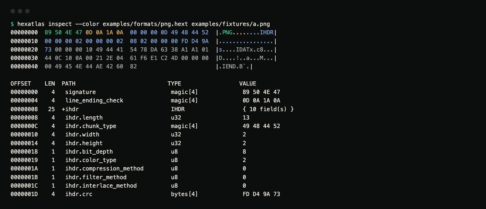
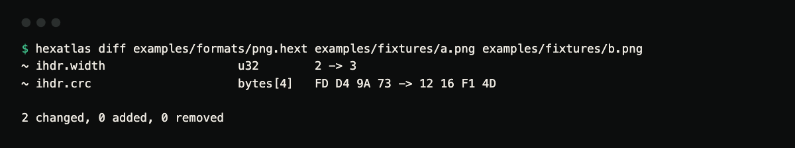
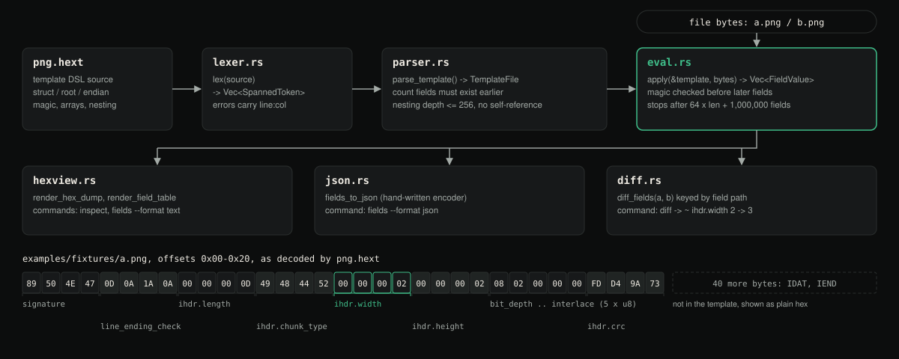

# hexatlas

Describe a binary format once in a small template language, then use that
template to annotate a hex dump, list decoded fields, or diff two files field by
field.



*Terminal capture: `inspect --color` on the bundled 2x2 PNG. The 33 header bytes are coloured by the template field that owns them; the IDAT and IEND bytes after them are not in the template and stay grey.*



*Terminal capture: `diff` between the 2x2 and 3x2 fixtures reports the change by field path.*

**Status:** version 0.1.0, a working command-line tool and library. Not published
on crates.io. CI runs the tests on Linux, macOS and Windows and diffs the README's
example output against the release binary.

```
hexatlas check   <template>                                # parse and validate a template
hexatlas inspect <template> <file> [--color] [--no-hex]    # annotated hex dump + field table
hexatlas fields  <template> <file> [--format text|json]    # decoded fields
hexatlas diff    <template> <file-a> <file-b>              # field-level structural diff
```

## How it differs from a hex editor

Hex editors usually make you annotate each file by hand, and byte-level diff
tools (`cmp`, `vbindiff`, `radiff2`) compare two files as plain byte streams.
hexatlas keeps the format description separate from the file:

- **The template is a reusable file.** `png.hext` names and types the PNG
  signature and IHDR chunk once. `inspect`, `fields` and `diff` all apply it, to
  as many files as you like.
- **Diffs are by field path, not by byte offset.** `diff` decodes both files
  through the same template and reports `ihdr.width  2 -> 3`. When an array has
  a different length in each file, the extra element shows up as one `+` line
  (for example `items[2]`) instead of every later byte appearing to change.
- **Templates are checked before they touch a file.** Magic bytes, template-wide
  or per-field endianness, nested structs and arrays sized by an earlier field
  (`items: u16[count]`) are part of the grammar. An array count that names a
  missing or later field, an undefined struct, or a struct that contains itself
  is rejected at parse time.
- **A template can describe part of a file.** The bundled example decodes only
  the fixed 33-byte PNG header. The rest of the file (compressed image data,
  `IEND`) is still shown in the hex dump, just without annotations.

## The template DSL

A `.hext` template is a sequence of `struct` definitions plus one `root`
declaration naming the struct applied at offset 0. See
[`examples/formats/png.hext`](examples/formats/png.hext) for a complete,
real example (PNG's fixed-shape signature + IHDR chunk). Lines starting with `#`
are comments.

```hext
endian be;

struct IHDR {
    length: u32;
    chunk_type: magic "IHDR";
    width: u32;
    height: u32;
    bit_depth: u8;
    color_type: u8;
    compression_method: u8;
    filter_method: u8;
    interlace_method: u8;
    crc: bytes[4];
}

struct PngHeader {
    signature: magic 0x89504E47;
    line_ending_check: magic 0x0D0A1A0A;
    ihdr: IHDR;
}

root PngHeader;
```

Field types:

| Syntax                       | Meaning                                                              |
|-------------------------------|-----------------------------------------------------------------------|
| `u8 u16 u32 u64`               | unsigned integers                                                     |
| `i8 i16 i32 i64`               | signed integers (two's complement)                                    |
| `f32 f64`                      | IEEE-754 floats                                                       |
| `u16le` / `u16be` (any width)  | per-field endianness override                                         |
| `magic "text"` / `magic 0xHEX` | a literal byte sequence that must match exactly, or decoding fails    |
| `ascii[N]`                     | fixed-width text, trailing NUL padding trimmed                        |
| `cstr[N]`                      | fixed-size buffer holding a NUL-terminated string                     |
| `bytes[N]`                     | an opaque N-byte blob, rendered as hex                                |
| `SomeStruct`                   | a nested struct, by name                                              |
| `Type[N]`                      | a fixed-length array of a numeric type or a struct                    |
| `Type[some_earlier_field]`     | an array whose length is read from an earlier sibling integer field   |

`endian le;` / `endian be;` at the top of the file sets the template-wide
default (little-endian if omitted); any scalar field can override it.

Two details of literals: string literals accept the escapes `\0`, `\n`, `\t`,
`\\` and `\"`, and a hex magic such as `magic 0x00CAFE` is stored as the shortest
big-endian byte sequence for that number, so leading zero bytes are dropped
(that example matches the two bytes `CA FE`). To require a leading zero, put
`magic "\0"` in its own field before the rest.

## Usage, with real output

The commands below were run against
[`examples/formats/png.hext`](examples/formats/png.hext) and two tiny, real
PNGs generated for this repo
([`examples/fixtures/a.png`](examples/fixtures/a.png) is 2x2,
[`b.png`](examples/fixtures/b.png) is 3x2). Every command's output shown
here is checked byte-for-byte in CI against
[`tests/fixtures/`](tests/fixtures) by the `dogfood` job in
[`.github/workflows/ci.yml`](.github/workflows/ci.yml).

### `hexatlas check`

```
$ hexatlas check examples/formats/png.hext
template OK: examples/formats/png.hext
default endian: be
root struct: PngHeader
structs:
  IHDR (10 field(s))
    length: u32
    chunk_type: magic[4]
    width: u32
    height: u32
    bit_depth: u8
    color_type: u8
    compression_method: u8
    filter_method: u8
    interlace_method: u8
    crc: bytes[4]
  PngHeader (3 field(s))
    signature: magic[4]
    line_ending_check: magic[4]
    ihdr: IHDR
```

### `hexatlas inspect` (annotated hex dump + field table)

```
$ hexatlas inspect examples/formats/png.hext examples/fixtures/a.png
00000000  89 50 4E 47 0D 0A 1A 0A  00 00 00 0D 49 48 44 52  |.PNG........IHDR|
00000010  00 00 00 02 00 00 00 02  08 02 00 00 00 FD D4 9A  |................|
00000020  73 00 00 00 10 49 44 41  54 78 DA 63 38 A1 A1 01  |s....IDATx.c8...|
00000030  44 0C 10 0A 00 21 2E 04  61 F6 E1 C2 4D 00 00 00  |D....!..a...M...|
00000040  00 49 45 4E 44 AE 42 60  82                       |.IEND.B`.|

OFFSET    LEN  PATH                           TYPE                 VALUE
00000000    4   signature                      magic[4]             89 50 4E 47
00000004    4   line_ending_check              magic[4]             0D 0A 1A 0A
00000008   25  +ihdr                           IHDR                 { 10 field(s) }
00000008    4   ihdr.length                    u32                  13
0000000C    4   ihdr.chunk_type                magic[4]             49 48 44 52
00000010    4   ihdr.width                     u32                  2
00000014    4   ihdr.height                    u32                  2
00000018    1   ihdr.bit_depth                 u8                   8
00000019    1   ihdr.color_type                u8                   2
0000001A    1   ihdr.compression_method        u8                   0
0000001B    1   ihdr.filter_method             u8                   0
0000001C    1   ihdr.interlace_method          u8                   0
0000001D    4   ihdr.crc                       bytes[4]             FD D4 9A 73
```

Notice the header (offsets `0x00`-`0x20`) is fully annotated, while the
`IDAT`/`IEND` chunks past it are plain hex, because the template does not
describe them. `--color` gives each top-level field its own ANSI colour in the
hex and ASCII columns (see the capture at the top). `--no-hex` skips the dump
and prints only the field table.

### `hexatlas diff` (field-aware, not byte-aware)

```
$ hexatlas diff examples/formats/png.hext examples/fixtures/a.png examples/fixtures/b.png
~ ihdr.width                   u32        2 -> 3
~ ihdr.crc                     bytes[4]   FD D4 9A 73 -> 12 16 F1 4D

2 changed, 0 added, 0 removed
```

Only `width` and `crc` (which covers `width` in its checksum) changed
between the 2x2 and 3x2 fixtures. Every other header field is identical, so
the diff lists nothing else. When an array has a different length in the two
files, the array itself is reported as changed and each extra element is
listed as `+` or `-` by path (for example `items[2]`).

### `hexatlas fields --format json`

```
$ hexatlas fields examples/formats/png.hext examples/fixtures/a.png --format json
[
  {"path": "signature", "offset": 0, "len": 4, "kind": "leaf", "type": "magic[4]", "value": "89 50 4E 47", "raw_hex": "89 50 4E 47"},
  {"path": "line_ending_check", "offset": 4, "len": 4, "kind": "leaf", "type": "magic[4]", "value": "0D 0A 1A 0A", "raw_hex": "0D 0A 1A 0A"},
  {"path": "ihdr", "offset": 8, "len": 25, "kind": "group", "type": "IHDR", "value": "{ 10 field(s) }", "raw_hex": ""},
  {"path": "ihdr.length", "offset": 8, "len": 4, "kind": "leaf", "type": "u32", "value": "13", "raw_hex": "00 00 00 0D"},
  {"path": "ihdr.chunk_type", "offset": 12, "len": 4, "kind": "leaf", "type": "magic[4]", "value": "49 48 44 52", "raw_hex": "49 48 44 52"},
  {"path": "ihdr.width", "offset": 16, "len": 4, "kind": "leaf", "type": "u32", "value": "2", "raw_hex": "00 00 00 02"},
  ...
]
```

`--format text` (the default) prints the same field table `inspect` prints
below its hex dump.

### A template applied to the wrong file fails loudly

```
$ hexatlas inspect examples/formats/png.hext Cargo.toml
error: Cargo.toml (examples/formats/png.hext): magic mismatch at field `signature` (offset 0): expected [89 50 4E 47], found [5B 70 61 63]
```

Exit code 1. Fields are decoded in order, so a `magic` field fails at the
first mismatch and nothing after it is decoded. A file that ends early fails
the same way, naming the field and how many bytes it needed.

Exit codes: `0` success, `1` an unreadable file, a template error or a decode
error, `2` invalid command-line arguments.

Template errors from the parser carry a line and column. Semantic errors found
after parsing (an unknown struct, a bad array count, a cycle) currently print
`line 0, col 0`, so search the message for the struct and field names instead.

## Limits on untrusted templates and files

Templates and files are both treated as untrusted. Struct nesting is limited
to 256 levels (checked at parse time, in linear time even for heavily shared
sub-structs), and evaluation stops with an error after
`64 × file size + 1,000,000` decoded fields, so a template with zero-sized
array elements or exponential nesting fails fast instead of hanging. Report
vulnerabilities as described in [SECURITY.md](SECURITY.md).

## Architecture



*Diagram of the modules (not a screenshot), with the bytes of `a.png` mapped to template fields.*

The library crate exposes the same pipeline: `parser::parse_template`,
`eval::apply`, then `hexview`, `json` or `diff` on the resulting fields. The
doctest in [`src/lib.rs`](src/lib.rs) is a minimal example.

## Installation

```
git clone https://github.com/hellpuffyt/hexatlas
cd hexatlas
cargo install --path .
```

Needs a stable Rust toolchain (CI uses the current stable; no minimum version
is declared). The only dependency is [`clap`](https://crates.io/crates/clap) for
argument parsing. The lexer, parser, evaluator, hex renderer, diff engine and
JSON encoder are written by hand.

## Development

```
cargo test --all-targets   # 60 unit + 8 CLI integration + 3 fuzz tests
cargo test --doc           # the doctest in src/lib.rs
cargo build --release      # then the dogfood checks in ci.yml
cargo fmt --all -- --check
cargo clippy --all-targets -- -D warnings
```

See [CONTRIBUTING.md](CONTRIBUTING.md) for more.

## License

MIT. See [LICENSE](LICENSE).
